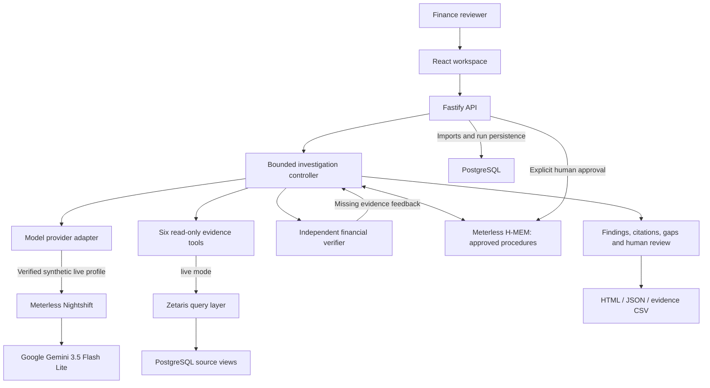

# FinTrace — Evidence-backed payment investigations

FinTrace helps accounts-payable and finance-operations teams answer **why a payment does not reconcile**, with inspectable evidence and explicit uncertainty. A bounded model planner selects read-only evidence tools; an independent deterministic verifier evaluates financial claims; a person reviews the result.

**Track:** 02 — The Agent That Can Explain Why.

> **Submission status:** Four fresh synthetic investigations passed through PostgreSQL + Zetaris + Nightshift + Google `gemini-3.5-flash-lite`, including memory drafting, scripted review, persistence and later recall. All 17 business model calls matched Nightshift Runtime explanations. The published source also passed a [fresh-clone installation and runtime check](docs/submission/VALIDATION.md#public-repository-fresh-clone-verification--27-october-2026). See the [acceptance evidence](docs/submission/NIGHTSHIFT_ACCEPTANCE.md) and separate [three-feed USL/data-quality package](docs/submission/ZETARIS_USL.md). Final video, slides, disclosures and HackOS submission remain team tasks; use the [requirements checklist](docs/submission/REQUIREMENTS.md).

## Start here

- [Submission requirements and remaining gates](docs/submission/REQUIREMENTS.md)
- [Sponsor technology explanation](docs/submission/SPONSOR_EXPLANATION.md)
- [Submission-form copy and disclosures](docs/submission/SUBMISSION_COPY.md)
- [Slides and demo handoff for teammates](docs/submission/TEAM_HANDOFF.md)
- [Nightshift setup and evidence checklist](docs/submission/NIGHTSHIFT_SETUP.md)
- [Current verification record](docs/submission/VALIDATION.md)
- [Publishing and teammate handoff checklist](docs/submission/PUBLISH_CHECKLIST.md)

## What the application does

1. Import a validated synthetic dataset or select a built-in review packet.
2. Investigate a payment using six fixed read-only tools.
3. Inspect findings, source records, coverage gaps, checks and recorded activity.
4. Accept findings or request changes; optionally approve a reusable investigation procedure.
5. Reuse approved H-MEM procedures in later investigations and export HTML, JSON or evidence CSV.

Supported checks cover duplicate disbursements (F06), stale vendor instructions (F11), missing bank settlement (F12), and settlement fees/reconciliation differences (F14). Outcomes are `anomaly_supported`, `no_anomaly_supported`, or `insufficient_evidence`. A failed API request is a technical failure, not evidence that a transaction is missing.

FinTrace does not execute payments, post journal entries or make autonomous business decisions. Findings and action suggestions come from the verifier's implemented rules, not unrestricted model assertions.

## Architecture



The controller has a planner and an independent verifier; it is not a swarm of autonomous agents. It limits investigations to six iterations, a twelve-slot cumulative table-query budget and a five-minute deadline. The first tool is `overview`; later selections respond to missing-evidence feedback. The model cannot issue arbitrary SQL or override the financial verifier.

| Tool | Source tables | Purpose |
|---|---|---|
| `overview` | payments, invoices, vendors | Establish payment context |
| `allocations` | payment_allocations | Check allocation and duplicate-payment evidence |
| `settlements` | bank_transactions | Inspect settlement and return records |
| `vendor_history` | vendor_change_log | Check instruction changes and effective times |
| `ledger` | gl_entries | Inspect payment and fee accounting |
| `processor_events` | audit_log | Check processing events when needed |

Nine tables are validated on import; `bank_statements` is also included in the data contract but is not independently queried by these six tools. In live mode, investigation evidence passes through Zetaris. Imports and application persistence use PostgreSQL directly. These tools query one PostgreSQL source. A separate [USL scoring demonstration](docs/submission/ZETARIS_USL.md) joins three simulated feeds over PostgreSQL, CSV and HTTP; it includes source assets, DDL, six exploration queries, three USL queries, native quality checks and a hand-written comparison. The feeds are synthetic, and the application evidence contract continues to use its existing immutable snapshots.

## Quick start: no keys or Docker required

Requirements: Node.js 22 or later and npm. Prepared synthetic examples are included; Python is only needed to regenerate the upstream dataset.

```powershell
npm ci
npm run build
$env:FINTRACE_MODE = 'fixture'
npm run dev
```

Open [http://localhost:4310](http://localhost:4310). Keep the server terminal open. On macOS/Linux, use `FINTRACE_MODE=fixture npm run dev` for the last two lines.

Select a built-in dataset in **Case inbox**, then start an investigation. Alternatively, import `data/fresh-manual/fresh-test-bundle.json` from **Datasets**. Review Findings, Validation and Activity log, then use Review findings and Export. Closing the investigation dialog does not cancel the running investigation; use its cancellation control to stop it.

For UI development, run `npm run dev:web` in a second terminal. The API uses port 4310; the frontend development server proxies API requests there. Local state is written below `.local/`.

### Three reproducible sample outcomes

These are expected results from synthetic reference packets, not measured customer outcomes. Built-in packets are seeded on normal startup.

| Dataset to select | Expected outcome | What to inspect |
|---|---|---|
| Review packet 001 | `anomaly_supported`, F06 | Duplicate disbursement evidence and its source citations |
| Review packet 049 | `no_anomaly_supported`, NO_FAILURE | Evidence supporting a normal payment |
| Coverage packet 001 | `insufficient_evidence`, EVIDENCE_GAP | Incomplete coverage and withheld conclusion |

Use the focused payment exposed by the selected dataset. Reused completed runs retain their original mode/provider: use a fresh namespace or an explicitly new investigation when validating a different provider. Sample answers and benchmark labels must not be added to model context.

## Execution profiles

| Profile | Evidence | Planner | Purpose |
|---|---|---|---|
| `fixture` | Local immutable synthetic snapshots | Deterministic tool selection | Offline fallback and UI/reproducibility checks |
| `local-model` | Local snapshots | Selected real provider | Isolated model tests; no live Zetaris evidence |
| `live` | Zetaris over registered PostgreSQL views | Selected real provider | Full integration |

All profiles share the same independent verifier. Fixture is the project's offline/sample fallback; it uses `FINTRACE_MODE=fixture`, not an additional `SAMPLE_MODE` flag. It is not a substitute for the required real sponsor-connected demo.

### Competition profile: Nightshift is the primary provider

Follow [NIGHTSHIFT_SETUP.md](docs/submission/NIGHTSHIFT_SETUP.md) and [INTEGRATIONS.md](docs/INTEGRATIONS.md). Configure PostgreSQL and Zetaris, install the official Nightshift runtime with an API endpoint, and configure a supported cloud provider inside Nightshift. The tested Mac route uses Google `gemini-3.5-flash-lite`; verify availability and quota on your own installation.

Copy `.env.example` to `.env.local` only if no local configuration already exists. Set the following values using the actual runtime configuration:

```dotenv
FINTRACE_MODE=live
MODEL_PROVIDER=meterless
METERLESS_BASE_URL=http://127.0.0.1:8088/v1
METERLESS_RUNTIME_TOKEN=<your Nightshift runtime token>
METERLESS_MODEL=<model ID exposed by your runtime>
# Tested demo uses gemini-3.5-flash-lite and 5-second request spacing.
METERLESS_MIN_REQUEST_INTERVAL_MS=5000
```

The base URL above was verified on the tested Mac; confirm the actual address on your machine. Keep cloud credentials in Nightshift for this route; the FinTrace Meterless adapter uses the Runtime token. Set `DATABASE_URL` and the Zetaris fields as documented, then restart FinTrace. Remove a shell-level fixture override first (`Remove-Item Env:FINTRACE_MODE -ErrorAction SilentlyContinue` in PowerShell).

```powershell
npm run preflight:submission
npm run preflight:submission -- --live
npm run verify:nightshift -- --connect
```

The first command checks configuration without connecting. The second contacts the services and makes a real model request that consumes API quota. The third runs four fresh synthetic business scenarios, a real memory draft, scripted review, application recreation and recall, and checks Runtime explanations. It writes synthetic records and defaults to a separate memory namespace. Successful technical checks do not certify the complete submission.

Direct OpenAI, DeepSeek and NVIDIA adapters remain available for development. They are not the final Nightshift submission route. No automatic direct-provider or fixture fallback occurs when a selected model fails. See [provider configuration](docs/INTEGRATIONS.md#model-provider).

## Meterless H-MEM feature

After completing an investigation, select **Review findings → Suggest memory**. The model proposes at most one reusable evidence-gathering procedure. Edit it, select its workspace/vendor scope, accept the findings, explicitly approve the memory, and save the review. A draft alone is not eligible for recall.

Later investigations may recall up to five approved procedures with provenance and match explanations. **Investigation memories** supports deactivation/restoration. Old reports retain their original memory snapshots. New evidence is imported as a new immutable version; the user explicitly updates the investigation. Memory changes do not automatically trigger paid reruns.

Memory influences evidence-tool priorities, not financial truth. The integration uses Meterless's reference H-MEM with deterministic hash embeddings and local keyword/bigram retrieval. It does not claim production semantic embeddings, automatic dreaming or reduced token costs.

## Tests

Run offline checks with fixture explicitly selected:

```powershell
$env:FINTRACE_MODE = 'fixture'
npm test
npm run typecheck
npm run build
npx playwright install chromium
npm run test:browser
npm run verify:hmem
npm run evaluate
```

`verify:hmem` checks the application lifecycle and with/without-memory scenarios. The vendored engine conformance command is:

```powershell
npx tsx third_party/meterless/engines/hmem/conformance/runner.ts
```

For a real-model H-MEM check, use `FINTRACE_MODE=local-model`, `MODEL_PROVIDER=meterless`, valid Runtime settings, then `npm run verify:hmem -- --connect`. That experiment uses local evidence and does not prove Zetaris integration. Full live evidence requires the separate business checks and UI demonstration.

See [current verification](docs/submission/VALIDATION.md) for the 189 passing unit/API tests and the complete [Nightshift synthetic acceptance](docs/submission/NIGHTSHIFT_ACCEPTANCE.md). Historical results include 15/15 live business runs through direct OpenAI and an H-MEM local-model experiment with 12/12 expected outcomes. Selected synthetic checks do not establish real-world accuracy, generalization or an advantage over rules. The historical H-MEM comparison did not reduce total request count and used more tokens.

## Implementation map

- `apps/web/src`: React workspace, investigations, evidence views and reviews.
- `apps/api/src/service.ts`: bounded orchestration and trace persistence.
- `apps/api/src/integrations`: model, Zetaris and H-MEM adapters.
- `apps/api/src/verifier.ts`: deterministic financial checks.
- `packages/contracts` and `packages/data`: shared schemas and import validation.
- `tests` and `scripts`: unit/API/browser tests, preflight and acceptance tools.
- `docs/submission`: English publication and teammate handoff materials.

## Provenance, limitations and release scope

Synthetic source data derives from **FinRCA-AI-Bench**, pinned to `76c93ec32536e29826e2ab9e68b58e0351410bc7` (MIT). Meterless H-MEM is pinned to `1742dec56a66e58eef9dda2d2b865823758ca8cd` (Apache-2.0). These are third-party components, not original FinTrace algorithms. See [DATA.md](docs/DATA.md), [THIRD_PARTY_NOTICES.md](THIRD_PARTY_NOTICES.md), and the [MIT project license](LICENSE).

FinTrace is a local, single-instance prototype. Production authentication, multi-instance guarantees, real-customer impact, statistically meaningful model comparisons and NVIDIA/Nemotron execution remain unverified. The tested Nightshift route is backed by matching Runtime decisions and model/provider metadata; these explanations are unsigned. A returned model alias alone does not prove the underlying route.

`PUBLIC_FILES.txt` defines the source-release allowlist. Do not upload `.env.local`, `.local/`, `.git/`, personal research, raw runtime reports, credentials, dependencies or build caches. New submission documents are English. Older Chinese technical notes remain historical references; the current submission checklist supersedes their older competition-requirement interpretations. Public repository visibility, final slides, video and HackOS submission are completed by the team.
