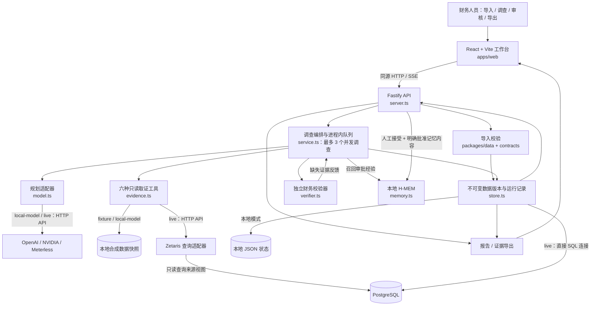
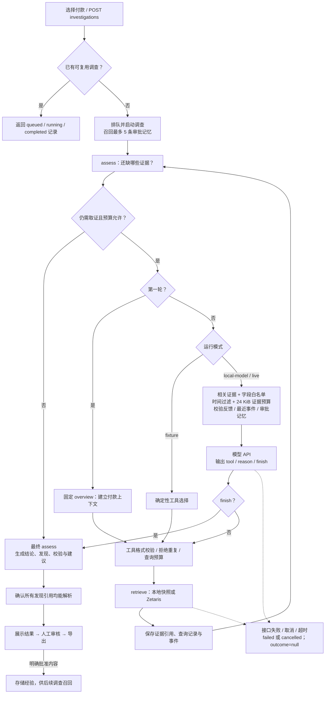

# FinTrace — 可追溯的付款异常调查工作台

FinTrace is an evidence-based payment investigation workspace: a constrained agent retrieves evidence, a deterministic verifier evaluates financial claims, and a human reviews the result.

面向应付账款与财务运营人员，把“这笔付款为什么异常”转成可复核的过程：**导入数据 → 选择付款 → 检索证据 → 独立校验 → 展示发现与证据缺口 → 人工审核 → 导出报告**。

当前成果是可本地运行的端到端原型，支持离线演示、真实模型配合本地合成数据，以及 PostgreSQL + Zetaris + OpenAI 的 `live` 调查路径。2026-10-26 的本地 Docker 验证中，live preflight 分别确认 PostgreSQL 已连接、Zetaris 查询成功、OpenAI 模型已响应；随后一个正常付款案例和一个费用异常案例均完成端到端调查。该结果验证的是合成数据上的连接与工作流，不代表真实业务准确率。NVIDIA 和 Meterless Runtime 仍未完成 live 验证。

## 这个项目完成了什么

| 完成的工作 | 具体能力 | 主要实现 |
|---|---|---|
| 财务调查工作台 | 付款收件箱、搜索筛选、结果总览、实时调查过程、证据详情、校验记录、人工审核 | [App.tsx](apps/web/src/App.tsx)、[ResultsOverview.tsx](apps/web/src/ResultsOverview.tsx)、[InvestigationProgress.tsx](apps/web/src/InvestigationProgress.tsx) |
| 数据导入与版本管理 | JSON bundle 或 manifest + 九张 CSV；类型、金额、日期、主键与关联校验；不可变版本、版本号复制 | [packages/data](packages/data/src/index.ts)、[store.ts](apps/api/src/store.ts) |
| 有边界的调查 Agent | 六种固定取证工具、模型规划、反馈循环、取消、超时、恢复、结果复用、批量调查 | [service.ts](apps/api/src/service.ts) |
| 独立财务校验 | 重复付款 F06、旧供应商信息 F11、缺少银行结算 F12、费用/金额对账 F14；正常及证据不足 | [verifier.ts](apps/api/src/verifier.ts) |
| 多模式与模型接入 | fixture / local-model / live；OpenAI、DeepSeek、NVIDIA、Meterless 统一适配；请求状态与用量轨迹 | [config.ts](apps/api/src/config.ts)、[model.ts](apps/api/src/integrations/model.ts) |
| 可审核的记忆 | 召回已批准经验；审核接受且明确批准内容后才能写入；命名空间隔离 | [memory.ts](apps/api/src/integrations/memory.ts) |
| 报告与验证体系 | HTML / JSON / 证据 CSV 导出；单元、集成、浏览器回归；合成参考集评估 | [export.ts](apps/api/src/export.ts)、[tests](tests)、[evaluation](evaluation) |

项目开发的核心工作是把这些部分连成可追踪、可失败、可人工复核的工作流。FinRCA 数据生成器与 Meterless H-MEM 是注明来源的第三方组件，不能将它们描述为本项目原创算法。

## 项目整体结构图



live 调查取证通过 Zetaris；数据导入和应用状态存储直接使用 PostgreSQL。该路径已在本地 Docker 环境使用九个只读来源视图完成合成数据联调；其他部署仍需按各自网络、凭据和命名空间重新配置与验证。

## Agent 在项目里扮演什么角色

**Agent 是受限的证据调查协调者。** 它根据校验器指出的缺口选择下一项取证工具，并解释查询原因。最终财务结论、发现说明和建议动作由独立规则生成；人工负责审核和后续业务处理。

| 角色 | 负责什么 | 边界 |
|---|---|---|
| 编排器 `InvestigationService` | 创建/复用运行、排队、执行工具、记录事件、执行预算与取消 | 单进程队列，非分布式任务系统 |
| 模型规划器 `provider.next()` | 输出 `tool`、`reason`、`finish`，选择取证顺序或提前停止 | 不能输出任意 SQL、修改源记录、裁定财务真相 |
| 校验器 `assess()` | 金额、时间、覆盖、关系校验；生成 outcome / findings / checks / actions | 仅覆盖已实现的财务规则 |
| 人工审核者 | 接受或要求修改、写备注、明确批准可复用经验 | 不自动执行付款、冲正或记账；要求修改不自动重跑 |



执行边界：最多 6 轮循环（首轮固定 `overview`）、累计表查询槽位达到 12 时停止继续查询、5 分钟执行时限。`completed` 不等于“有异常”或“已人工审核”；财务结果单独记录为 `anomaly_supported`、`no_anomaly_supported` 或 `insufficient_evidence`。技术失败不能推断为“没有银行记录”。

| 工具 | 读取的数据表 | 用途 |
|---|---|---|
| `overview` | payments、invoices、vendors | 付款、发票和供应商上下文 |
| `allocations` | payment_allocations | 付款分配与重复付款判断 |
| `settlements` | bank_transactions | 结算、退回与金额核对 |
| `vendor_history` | vendor_change_log | 银行信息变更及生效时间 |
| `ledger` | gl_entries | 付款及费用分录 |
| `processor_events` | audit_log | 按需补充处理器事件证据 |

`bank_statements` 是第九张可导入表，但不在六个工具的映射中。上游 Python RAG / GraphRAG 研究模块也不属于当前网页 Agent 执行链。详细代码与 API 对照见 [当前 Agent 架构](docs/AGENT_ARCHITECTURE.zh-CN.md)。

## 目录结构

```text
.
├── apps/
│   ├── web/src/                 React 工作台、结果总览、客户端队列与 API
│   └── api/src/
│       ├── server.ts            HTTP 路由、SSE、导入与审核
│       ├── service.ts           Agent 生命周期和执行循环
│       ├── context.ts           模型证据预算与字段白名单
│       ├── observation.ts       相关证据及观察时间边界
│       ├── evidence.ts          六个工具与数据表映射
│       ├── verifier.ts          独立财务判断
│       ├── store.ts             文件 / PostgreSQL 持久化
│       ├── export.ts            HTML / JSON / CSV
│       ├── cli.ts               调查、评估、数据库初始化
│       └── integrations/       model / zetaris / memory 适配器
├── packages/
│   ├── contracts/              共享 TypeScript 类型与 Zod 校验
│   └── data/                   导入校验、schema、固定版本 FinRCA 源码
├── data/                       合成 review packets、手测包与来源信息
├── evaluation/labels/          评估专用答案，不向网页 Agent 提供
├── third_party/meterless/       H-MEM 参考源码与许可证
├── tests/                      Vitest 与 Playwright 回归测试
├── scripts/                    数据准备、预检与验证脚本
├── docs/                       API、集成、评估与架构文档
├── compose.yaml                可选本地 PostgreSQL
├── .env.example                无真实密钥的配置模板
└── PUBLIC_FILES.txt             GitHub 发布文件白名单
```

技术选择：TypeScript monorepo 共享前后端契约；Zod 在输入边界校验；Decimal.js 避免浮点金额误差；不可变快照、版本哈希和证据引用支持复核；fixture 模式让本地开发不依赖付费模型或外部数据库。

## 本地运行

需要 Node.js 22+。使用准备好的数据时不需要 Python 或 Docker。

```powershell
npm ci
npm run build
$env:FINTRACE_MODE = "fixture"
npm run dev
```

打开 [http://localhost:4310](http://localhost:4310)。选择内置付款案例并启动调查，或在 Datasets 导入 [合成手测包](data/openai-manual/01-main-bundle.json)。查看 Findings、Validation 和 Activity log，审核后导出报告。Windows 也可使用 `start-fintrace.cmd`。

前端热更新：另开终端运行 `npm run dev:web`，其 API 代理指向 4310。应用默认绑定 localhost，本地状态写入忽略目录 `.local/`。这是本地原型，未实现生产级多用户认证和部署方案。

在 **Case inbox** 点击 **Investigate / Start investigation**，或仅勾选一笔后点击 **Investigate selected (1)**，都会在原列表上打开调查窗口，保留当前筛选、分页和选中付款。勾选多笔仍使用批量队列。“调查过程”通过现有 1.5 秒轮询读取真实记录，逐条逐字显示工具、查询目的、结果摘要及对应证据。后台提前完成时会明确提示正在展示已记录过程；展示结束后自动收起，再在同一窗口呈现结论、发现、证据、人工审核、记忆编辑和导出。过程和状态统一显示英文；可以点击 **Skip to results** 跳过剩余动画，已完成记录可用 **Expand investigation activity** 展开查看。系统设置减少动态效果时直接显示文字，不提供单独的回放按钮。新文字增长时弹窗内容自动跟到最新位置；手动向上阅读会暂停，滚回底部或点击 **Jump to latest** 后恢复。每步的 **Evidence (N)** 默认收起，结果中的 **Evidence** 表格也可以折叠；查看证据或审核时保留阅读位置。

关闭窗口只隐藏界面，调查仍在后台继续；“停止调查”才会发出取消请求。同一浏览器会话中关闭再打开可继续查看，已完成案例直接使用保存结果。失败或已停止时保留过程，由用户选择是否重新调查。窗口链接带有 `?investigation=…&view=dialog`，刷新可恢复调查；原来的 `?investigation=…` 详情页链接仍可用。该呈现不增加模型请求，也不改变财务判断规则；详细执行事件仍可在 Activity log 中查看。

### 三种运行模式

| `FINTRACE_MODE` | 证据来源 | 规划方式 | 外部依赖 |
|---|---|---|---|
| `fixture` | 本地合成快照 | 确定性工具选择 | 无模型/数据库账户 |
| `local-model` | 本地快照 | 真实模型 | 所选模型 API |
| `live` | Zetaris 读取 PostgreSQL 来源视图 | 真实模型 | PostgreSQL + Zetaris + 所选模型 API |

三种模式复用同一个校验器。需要真实模型时，将 `.env.example` 复制为 `.env.local`（不要覆盖已有配置），在本地填写：

```dotenv
FINTRACE_MODE=local-model
MODEL_PROVIDER=openai
OPENAI_API_KEY=<your-local-key>
OPENAI_BASE_URL=https://api.openai.com/v1
OPENAI_MODEL=gpt-4.1-mini
FINTRACE_STORAGE_DIR=.local/manual-openai
```

使用 DeepSeek 时，将模型配置改为下面这些字段，保留自己的数据目录配置：

```dotenv
FINTRACE_MODE=local-model
MODEL_PROVIDER=deepseek
DEEPSEEK_BASE_URL=https://api.deepseek.com
DEEPSEEK_MODEL=deepseek-flash
DEEPSEEK_API_KEY=<your-local-key>
```

DeepSeek 使用独立适配器处理 JSON 输出，不能只替换 OpenAI 的 Base URL。当前模型名与接口请以 [DeepSeek 官方文档](https://api-docs.deepseek.com/) 为准。2026-10-27 已用独立合成正常案例完成一次真实 DeepSeek 调查，4 次模型请求成功；该结果验证连接及工作流，不代表真实业务准确率。私人凭证与验证轨迹不随源码交接。

修改配置后重启服务，并清除终端中已有的 `FINTRACE_MODE=fixture` 覆盖值。`npm run preflight` 仅检查配置；`npm run preflight -- --live` 在模型模式下会发出真实、可能计费的请求。模型错误会明确失败，不会静默回退到 fixture。完整配置见 [INTEGRATIONS.md](docs/INTEGRATIONS.md)。

`npm run dev` 是前台进程，使用期间保留该终端。交接时只提交 `.env.example`；队友在自己的 `.env.local` 中填写凭证并按相同命令启动。已保存的 fixture 结果不会转换成真实模型结果，验证新模型时选择未调查案例或明确更新调查。

## 验证与证据边界

```powershell
$env:FINTRACE_MODE = "fixture"
npm run typecheck
npm test
npm run build
npx playwright install chromium
npm run test:browser
npm run evaluate
```

`evaluate` 使用独立状态目录；`npm run evaluate -- heldout` 仅评估保留集。浏览器测试使用 4311 端口和隔离状态。测试产物、历史运行轨迹和个人环境配置不属于发布源码。

- **源码已实现：** 上述工作台、Agent 循环、校验器、数据版本、审核记忆和适配器。
- **历史离线记录：** 开发集 39/40、保留集 20/20、衍生覆盖压力集 10/10，均为小型合成参考集。fixture 与固定规则基线使用同一校验逻辑，不能据此宣称 AI 优势。详见 [评估说明](docs/EVALUATION.md)。
- **历史真实 API 记录：** 本地 2026-10-22 记录显示一个正常案例使用 OpenAI 完成调查，四次模型 HTTP 请求成功。这不是八案例真实模型评估，也不是本次发布重新执行的结果；原始请求轨迹不随源码发布。
- **live 联调记录：** 2026-10-26 在本地 Docker 环境完成 PostgreSQL、Zetaris 和 OpenAI preflight；Zetaris 能读取 `FINTRACE` 中已注册的九个只读来源视图。两个选定的合成案例完成调查：一个返回 `No anomaly supported`，一个返回 `Issues found`。调查活动记录包含成功的 Zetaris evidence query；原始运行轨迹和凭据不随源码发布。
- **尚未证明：** 真实客户效果、真实数据泛化、相对规则的收益、连续完整 live 评估、Meterless Runtime / NVIDIA live 接入及生产部署能力。

本次发布检查结果见 [RELEASE_VALIDATION.md](docs/RELEASE_VALIDATION.md)。

## 数据来源、原创边界与发布范围

- **FinRCA-AI-Bench**：固定提交 `76c93ec32536e29826e2ab9e68b58e0351410bc7`，MIT。提供生成器、源 schema 和合成财务基础。本项目增加 review packet 提取、覆盖变换、导入工作流及应用实现。
- **Meterless H-MEM**：固定提交 `1742dec56a66e58eef9dda2d2b865823758ca8cd`，Apache-2.0。使用本地参考引擎；embedding 是确定性 mock，未接入生产语义检索；自动 dreaming 未调用。
- **Zetaris**：应用通过受限查询适配器读取 PostgreSQL 中的九个 `fintrace_source` 只读视图；本地 Docker live 路径已验证。Zetaris 是治理查询层，PostgreSQL 仍是数据与运行状态的持久化来源。

保留必要第三方许可，见 [THIRD_PARTY_NOTICES.md](THIRD_PARTY_NOTICES.md) 和 [DATA.md](docs/DATA.md)。项目代码使用 [MIT License](LICENSE)。

GitHub 包仅发布白名单中的源码、配置模板、合成示例、测试和说明。`.env.local`、`.local/`、依赖/构建缓存、个人调研材料、原始运行报告、截图、视频和演示文稿不上传。开发工具及比赛合规需按实际使用情况另行说明；本 README 不证明比赛提交条件已经满足。

## H-MEM 比赛版闭环

已完成调查 → **Review findings → Suggest memory** → 编辑正文、选择当前工作区或供应商 → Accept findings + Approve a reusable memory → Save human review。模型仅在点击建议时调用；草稿持久保存，重复点击不会重复调用，失败后可显式重试或人工填写。

左侧 **Investigation memories** 可查看来源、批准时间及生成来源，停用或恢复经验。已批准正文不可直接修改：先停用旧经验，再从来源调查重新编辑批准。调查详情 **Activity log → Memories provided to planner** 展示本次召回快照与匹配依据；召回表示已提供给规划器，不代表模型必然采用。新证据继续通过手动导入修订版本和 **Update investigation** 处理，经验变化不会自动重跑调查。

- 离线验收：`$env:FINTRACE_MODE='fixture'; npm run verify:hmem`
- 真实模型验收：在发布目录配置进程环境后执行 `$env:FINTRACE_MODE='local-model'; npm run verify:hmem -- --connect`，会产生模型费用。
- [分层验收报告与约一分钟演示步骤](docs/HMEM_ACCEPTANCE.zh-CN.md)
- [API 与兼容边界](docs/API.md#h-mem-competition-lifecycle)

本轮仅使用现有 Meterless H-MEM store、检索评分和 trust ledger；保留本地 hash embedding 与中英关键词，不声称生产语义检索。没有新增 World Model、Scout、Markovian、Runtime、embedding 服务、自动监控或多用户权限系统。
